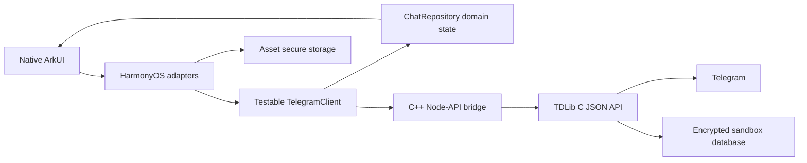

<p align="center">
  
</p>

<h1 align="center">Harlgram</h1>

<p align="center">An open-source native third-party Telegram client for HarmonyOS NEXT, built with ArkUI + TDLib and in active development.</p>

<p align="center">
  <a href="README.md">简体中文</a> · English ·
  <a href="https://github.com/GaryChangCN/harlgram">GitHub</a> ·
  <a href="https://garychangcn.github.io/harlgram/">Website</a> ·
  <a href="docs/TELEGRAM_WEB_PARITY.md">Feature progress</a>
</p>

Harlgram connects to Telegram through ArkTS / ArkUI, a C++ Node-API bridge, and TDLib. Its functional target is **Telegram Web A at phone sizes**, with HarmonyOS components for navigation, input, system pickers, and window behavior. The Android client is an architectural reference.

**This is an independent, unofficial, experimental project in early development. It is not affiliated with Telegram.** Real accounts and some core messaging flows work, but substantial gaps remain. This repository provides source code and a developer preview; it does not promise a stable release or app-store availability. Project website: [GitHub Pages](https://garychangcn.github.io/harlgram/).

<p align="center">
  
  
</p>

<p align="center"><sub>Privacy-redacted device captures composited into illustrative device frames. Unfolded-device validation is ongoing.</sub></p>

## Project progress

- [Features and validation scope](docs/FEATURES.en.md) · [Website features](https://garychangcn.github.io/harlgram/features.html)
- [Roadmap and acceptance](docs/ROADMAP.en.md) · [Website roadmap](https://garychangcn.github.io/harlgram/roadmap.html)
- [Changelog](CHANGELOG.en.md) · [Website changelog](https://garychangcn.github.io/harlgram/changelog.html)

## What works today

This summary reflects evidence recorded on **2026-11-01**. Implementation, host tests, SDK compilation, device behavior, and server synchronization are separate levels of evidence. See [current status](docs/STATUS.md) and the [Web A parity matrix](docs/TELEGRAM_WEB_PARITY.md) for the detailed scope. Most engineering documents are currently in Chinese.

| Area | Current scope and limits |
| --- | --- |
| Network and proxies | Multiple self-hosted routes, explicit selection/direct mode, configurable token headers, secure storage and legacy migration; Cloudflare messaging and media verified on a device without VPN. See [relay scope](docs/TELEGRAM_RELAY.md). |
| Real account login | TDLib authentication states, country/calling-code selection, phone number, code, and existing two-step password login. Users enter their own credentials. Physical-device login and session retention across normal update installs have been verified. |
| Chats and contacts | Real main chat list, avatars, unread counts, draft previews, history pagination, group senders, and dates. Existing contacts can open private chats. Current filters and search operate on loaded data only. |
| Text and drafts | Real text messaging, pending/failed states, and plain-text drafts. Cross-client behavior and draft preservation have evidence; full rich drafts and concurrent cross-client editing remain incomplete. |
| Message actions | Reply, edit, forward, delete, and copy entries follow server-provided permissions. Text edit, reply, forwarding to Saved Messages, and deletion for self were tested on a physical device and checked in Web A. Other content types and permission cases are not covered by those results. Copy has not yet been exercised on a device. |
| Photos and videos | Select up to 10 JPEG/PNG photos and MP4/MOV videos; remove items, add a caption, and send an album. Includes album grids, previous/next browsing, photo zoom, progressive video streaming, native AVPlayer playback, uncached seeking, temporary 2× on hold, ±30-second controls and seven playback speeds, and confirmed gallery export. Mixed albums were verified in both directions between a physical device and Web A. See [media scope and limits](docs/MEDIA.md). |
| Message display | Native formatted text, common RichMessage blocks, group avatars/grouping, forwarding/reply previews and aspect-aware media/albums; compared across three real groups. Complex blocks and full content-type parity remain incomplete; see [display scope](docs/MESSAGE_DISPLAY.md). |
| Storage management | Per-account category statistics and selective/per-chat cache clearing, chat-type retention, cache caps, network-specific photo/video/animation downloads, and traffic totals. Real statistics and Saved Messages video-cache clearing verified on a physical device. Background and upload-staging cleanup remain incomplete; see [storage details](docs/STORAGE_MANAGEMENT.md). |
| Native appearance | Official ArkUI navigation, floating tabs, and system menus; light, dark, and system appearance. Preference retention across updates/restarts and following Control Center changes were verified on a physical device. |
| Foldable layout | Static physical-device captures show single-column and unfolded two-pane layouts on Pura X Max. This does not establish complete fold transitions, rotation, split-screen behavior, or state preservation. |
| Offline preview | Fictional fixtures in an isolated local mode for UI development. Local changes are not cloud messages. |

### Known gaps

- **Discovery and organization:** server-side global/in-chat search, actual cloud folders, archive, full profiles, and shared media.
- **Messages and media:** selection, message pinning, reactions, full rich text, stickers/GIFs, files, voice, original-file/quality editing, further codec/streaming failure cases, and complete download controls, background cache cleanup, and upload-staging reclamation.
- **Account and platform features:** inactive-account synchronization/notifications and further isolation checks, group/channel management, full privacy/security settings, background notifications/push, voice/video calls, Stories, and more.
- **Further validation:** precise cross-page navigation, complete read semantics, photo-caption editing, additional permission/error cases; tablets, large screens, full fold transitions, landscape, and split screen have not completed acceptance testing. The API 24 compatibility path also lacks corresponding device evidence.

There is no background push pipeline yet; do not depend on this developer preview for important notifications. The [roadmap](docs/ROADMAP.md) describes the remaining scope. Core messaging is not full Web A parity.

## Architecture



- `.ts` modules contain domain models, request correlation, authentication states, and update handling; `.ets` modules contain ArkUI and HarmonyOS Kit integration.
- Pinned TDLib source is cross-compiled for **OHOS**. An Android `.so` is not a substitute. Native receiving uses zero-timeout polling to avoid blocking the UI.
- TDLib manages real messages. Offline fixtures and snapshots are separate. Database keys use Asset secure storage; appearance preferences have independent persistence.
- The app uses native ArkUI rather than a WebView shell. Responsive design uses available window width in `vp`, with design targets and verified coverage recorded separately.

See [architecture](docs/ARCHITECTURE.md), [UI guidelines](docs/UI_GUIDELINES.md), and the [responsive validation matrix](docs/RESPONSIVE_VALIDATION.md).

## Build from source

### 1. Prepare the environment

The complete scripted build has been validated on **macOS with DevEco Studio**. Other host platforms do not yet have full build evidence. Linux GitHub Actions checks cover platform-independent logic and public-file safety only.

| Dependency | Current baseline |
| --- | --- |
| DevEco Studio / HarmonyOS SDK | Install [official DevEco Studio](https://developer.huawei.com/consumer/cn/deveco-studio/). The installed and tested SDK baseline is `26.0.0.105`. |
| Project SDK | `targetSdkVersion: 26.0.0`; `compatibleSdkVersion: 6.1.1(24)`. A minimum declared version is not a device-validation claim. |
| Node / Java / Hvigor / OHPM / HDC | Scripts prefer DevEco's bundled tools; global installations are not required. |
| Host utilities | Git, Python 3, Perl, Make, curl, tar, shasum, `gperf`, and a working host C/C++ compiler. On macOS, Xcode Command Line Tools can supply the compiler; install `gperf` separately. |
| Native dependencies | TDLib `1.8.69` at `4c6377aa7386c39217878a9a56d581922ad37ca4`; OpenSSL `3.5.9`. The script uses SDK CMake, Ninja, Clang, and sysroot. |
| Device | A HarmonyOS device with debugging enabled and authorized. The current real-device baseline is API 26, `arm64-v8a`. |

Run these commands from the repository root:

```bash
git clone https://github.com/GaryChangCN/harlgram.git
cd harlgram

# Set this to the Contents directory if your installation differs.
export DEVECO_HOME="/Applications/DevEco-Studio.app/Contents"
./scripts/setup.sh
bash -c 'source scripts/env.sh; ohpm install'
./scripts/doctor.sh
```

`setup.sh` copies missing public API/signing templates, generates local build configuration, and enables repository Git hooks. It preserves existing configuration and installs no global tools. Paths containing spaces are supported.

### 2. Configure your Telegram application identity

**Builders provide the API configuration. End users only sign in to Telegram; they do not need to apply for an API ID.** Follow Telegram's [application registration instructions](https://core.telegram.org/api/obtaining_api_id), using API development tools at [my.telegram.org](https://my.telegram.org/) to obtain your own `api_id` and `api_hash`.

Edit only the ignored local file `config/telegram.local.json`. Its fields are `apiId` and `apiHash`; see the [public template](config/telegram.example.json). Never paste real values into issues, chats, screenshots, or commits.

```bash
./scripts/configure-telegram.sh
```

This generates the also-ignored `entry/src/main/ets/config/TelegramBuildConfig.ets`. An empty template permits a debug UI build but cannot authenticate a phone number. Release builds reject missing or invalid configuration. The repository does not ship Telegram's official app or sample API identity.

### 3. Build the native engine and configure signing

```bash
# This native script currently uses DEVECO_PATH separately; pass Contents.
DEVECO_PATH="$DEVECO_HOME" ./scripts/build-tdlib.sh
```

The script downloads pinned source, verifies the OpenSSL archive, generates host-side code, and cross-compiles the libraries. Its default output is `entry/libs/arm64-v8a/libtdjson.so`, with caches under `.local/third_party/`. The first build can take time; `BUILD_JOBS` controls parallelism. See [TDLib integration](docs/TELEGRAM_INTEGRATION.md) for individual stages. Native binaries and caches stay out of Git.

Open the project in DevEco and configure your own signing identity in local `build-profile.json5`. The public `build-profile.example.json5` contains no certificates. Preserve existing signing configuration. Telegram API identity, application signing, and user login are three separate steps.

### 4. Test, build, and install

```bash
./scripts/test-domain.sh
python3 scripts/check-public-tree.py
./scripts/build.sh

# Select your own device ID from doctor.sh; do not copy someone else's ID.
HDC_TARGET='<device-id>' ./scripts/install.sh
HDC_TARGET='<device-id>' ./scripts/run.sh
```

The signed output is `entry/build/default/outputs/default/entry-default-signed.hap`. `install.sh` performs an update install. Keep bundle identity and signing consistent; do not uninstall an app containing a real session or clear its data for testing. Users enter phone numbers, verification codes, and passwords themselves.

Use `./scripts/build.sh release` for a release build, then complete the version-specific checks in the [release guide](docs/RELEASE.md). Do not run concurrent Hvigor builds. See the [development guide](docs/DEVELOPMENT.md) for environment overrides, screenshots, transfer troubleshooting, and complete commands.

## Reading the test evidence

Tests in `tests/` use controlled transports to exercise request fields, permissions, draft races, state merging, storage paths, and photo geometry. They do not connect to real accounts and cannot prove server acceptance.

The [public source workflow](.github/workflows/checks.yml) runs domain/configuration tests and public-file checks on Ubuntu with Node 22. **It does not compile a HarmonyOS HAP, sign an application, or connect to a device.** SDK builds, physical-device interactions, and cross-client results are recorded separately in [device testing](docs/DEVICE_TESTING.md).

## AI-native development

Here, AI-native means an **evidence-based development process that another contributor can continue**. It does not mean sending user chats to AI or having an AI message editor in the product.

Start with [AGENTS.md](AGENTS.md) and [current status](docs/STATUS.md): read the relevant source and pinned protocol, define file ownership, make a small change, run meaningful tests, validate with the real SDK and designated device, and record both results and unverified cases. Contributors and agents sharing a checkout must preserve each other's changes, distinguish local state from cloud confirmation, and respect account-operation authorization.

| Document | Purpose |
| --- | --- |
| [AI workflow](docs/AI_WORKFLOW.md) | Scope, evidence, checks, and handoff rules |
| [Development guide](docs/DEVELOPMENT.md) | Tools, builds, signing, and device scripts |
| [Source map](docs/TELEGRAM_SOURCE_MAP.md) / [TDLib integration](docs/TELEGRAM_INTEGRATION.md) | Upstream evidence, pinned versions, and platform boundaries |
| [Web A parity matrix](docs/TELEGRAM_WEB_PARITY.md) / [Roadmap](docs/ROADMAP.md) | Feature gaps and acceptance criteria |
| [Current status](docs/STATUS.md) | Latest verification, known issues, and next steps |

## Contributing and security

Reproducible bug reports, native interaction improvements, protocol regression tests, and clearly scoped features are welcome. Read [CONTRIBUTING.md](CONTRIBUTING.md) and check the parity matrix before starting.

Report security problems privately as described in [SECURITY.md](SECURITY.md); use [GitHub Issues](https://github.com/GaryChangCN/harlgram/issues) for ordinary bugs. Do not upload real messages, account data, databases, keys, or unredacted device captures.

## License and acknowledgments

Harlgram's own code, scripts, documentation, and assets are licensed under **GPL-3.0-or-later**, except separately identified third-party material; see [LICENSE](LICENSE) and the [licensing guide](docs/LICENSING.md). TDLib uses the Boost Software License 1.0, OpenSSL uses Apache License 2.0, and other packaged dependencies and data retain their own licenses. See [THIRD_PARTY_NOTICES.md](THIRD_PARTY_NOTICES.md) for attribution, sources, and distribution notes. This publication covers source code; no HAP release is provided.

Thanks to Telegram, TDLib, OpenSSL, OpenHarmony / HarmonyOS developer tools, and the related open-source projects. The project name and interface do not imply endorsement by Telegram.
