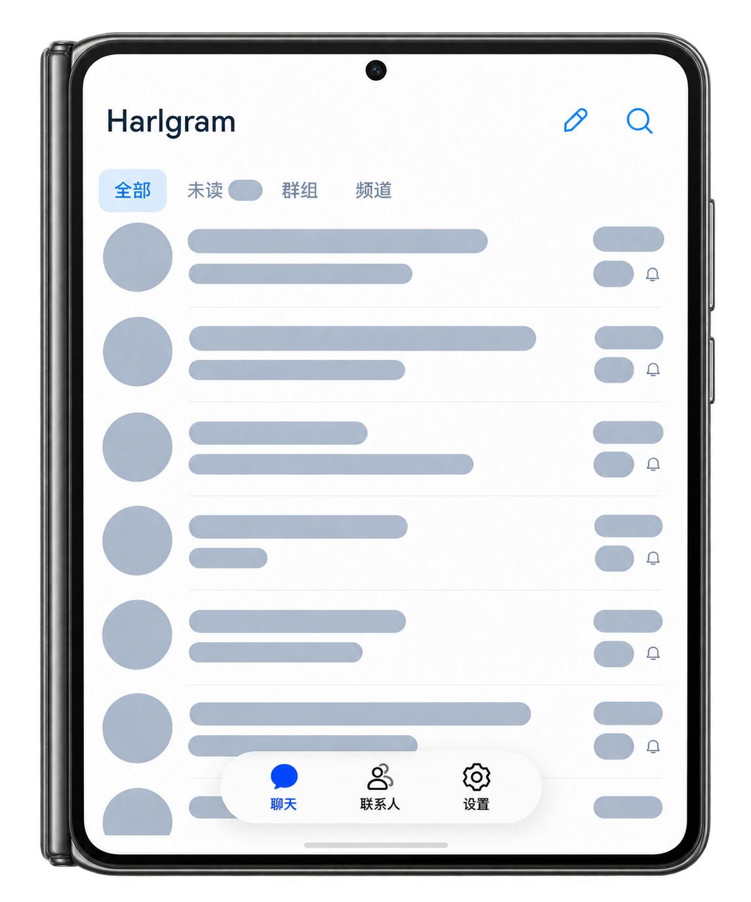
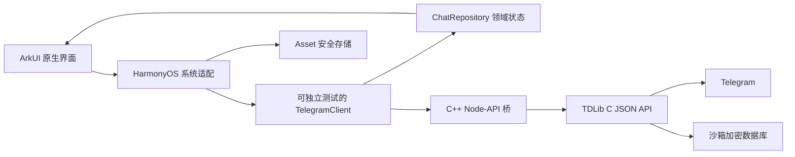

<p align="center">
  
</p>

<h1 align="center">Harlgram</h1>

<p align="center">开源的鸿蒙 HarmonyOS NEXT 原生 Telegram 第三方客户端，基于 ArkUI + TDLib，持续开发中。</p>

<p align="center">
  简体中文 · <a href="README.en.md">English</a> ·
  <a href="https://github.com/GaryChangCN/harlgram">GitHub</a> ·
  <a href="https://garychangcn.github.io/harlgram/">官网</a> ·
  <a href="docs/TELEGRAM_WEB_PARITY.md">功能进度</a>
</p>

Harlgram 使用 ArkTS / ArkUI、C++ Node-API 和 TDLib 接入 Telegram。功能目标参考 **Telegram Web A 的手机尺寸体验**，界面、导航、输入、系统选择器和窗口行为采用 HarmonyOS 官方组件；Android 源码作为架构参考。

**这是独立、非官方、仍在早期开发的实验性项目，不隶属于 Telegram。** 当前已打通真实账号与部分核心聊天流程，距离完整 Telegram 客户端仍有明显差距。本仓库以源码和开发预览为主，不承诺稳定发行版或应用商店可用性。项目官网：[GitHub Pages](https://garychangcn.github.io/harlgram/)。

<p align="center">
  
  
</p>

<p align="center"><sub>真机画面经隐私遮挡与机身示意合成；展开形态仍在持续验证。</sub></p>

## 项目进展

- [现有功能与验证范围](docs/FEATURES.md) · [官网功能页](https://garychangcn.github.io/harlgram/features.html)
- [路线图与验收条件](docs/ROADMAP.md) · [官网路线图](https://garychangcn.github.io/harlgram/roadmap.html)
- [更新日志](CHANGELOG.md) · [官网更新日志](https://garychangcn.github.io/harlgram/changelog.html)

## 目前可以做什么

以下是截至 **2026-11-01** 的能力摘要。实现、宿主机测试、SDK 编译、设备运行和服务端同步是不同层次的证据，详细记录见 [当前状态](docs/STATUS.md) 与 [Web A 对齐清单](docs/TELEGRAM_WEB_PARITY.md)。

| 能力 | 当前范围与验证边界 |
| --- | --- |
| 真实账号登录 | TDLib 认证状态、国家/区号选择、手机号、验证码和已有两步密码登录；登录由用户本人完成。真机登录及正常覆盖安装后保持登录已验证。 |
| 会话与联系人 | 真实主列表、头像、未读、草稿摘要、历史分页、群发送者与日期；已有联系人可打开私聊。当前列表筛选和搜索只针对已加载数据。 |
| 文本与草稿 | 真实文本收发、发送中/失败状态、纯文字草稿。已有跨端与保留草稿的验证，完整富草稿和跨端并发编辑仍待完善。 |
| 消息操作 | 根据服务端权限提供回复、编辑、转发、删除、复制入口。文本编辑、回复、转发到收藏夹及「仅为我」删除已在真机操作并由 Web A 同账号核对；其他内容类型和权限边界不能据此视为通过。复制入口尚未实机执行验收。 |
| 图片与视频 | 系统选择最多 10 项 JPEG/PNG 图片、MP4/MOV 视频，逐项移除、说明和分组发送；相册网格、前后浏览、图片缩放、视频边下边播与原生 AVPlayer、未缓存定位、长按临时 2×、前后 30 秒和七档倍速、经确认保存。真机与 Web 双向混合相册通过；格式、大小与待验证边界见 [媒体说明](docs/MEDIA.md) 和 [播放器验收](docs/VIDEO_PLAYER.md)。 |
| 消息展示 | 原生富文本、常见 RichMessage 区块、群头像与连续发言、转发/回复摘要、按比例媒体和相册；三个真实群已对照检查。复杂区块及完整消息类型仍有差距，见 [展示范围](docs/MESSAGE_DISPLAY.md)。 |
| 存储管理 | 当前账户分类占用与选择性/按会话清缓存，三类会话保留期限、缓存上限、按网络图片/视频/动图自动下载和网络用量。真机真实统计及收藏夹视频缓存清理通过；后台及上传暂存回收仍待完善，见 [存储管理](docs/STORAGE_MANAGEMENT.md)。 |
| 原生外观 | 官方 ArkUI 导航、浮动底栏、系统菜单；浅色、深色、跟随系统。真机覆盖安装、重启保留偏好及控制中心切色后跟随已验证。 |
| 折叠屏布局 | Pura X Max 已有未展开单栏与展开双栏的静态真机画面证据；不代表完整折叠切换、旋转、分屏与状态保持都已验收。 |
| 离线体验 | 使用虚构数据的独立本地模式，便于界面开发；本地写入不会成为云端消息。 |

### 明确的缺口

- **查找与组织**：服务端全局/聊天内搜索、真实云端文件夹、归档、完整资料页与共享媒体。
- **消息与媒体**：多选、消息置顶、反应、完整富文本、贴纸/GIF、文件、语音、原文件/压缩编辑、更多编码与流式异常场景、完整下载、后台缓存与上传暂存回收。
- **账号与系统能力**：非活动账户同步/通知与更多隔离场景、群/频道管理、完整隐私与安全设置、后台通知/推送、语音视频通话、Stories 等。
- **进一步验收**：跨页精确定位、完整已读语义、图片说明编辑、更多权限与失败场景；平板、大屏、完整折叠切换、横屏与分屏尚未完成验收。API 24 兼容路径也未取得对应设备证据。

当前没有后台推送链路，不应依赖本开发预览接收重要通知。完整范围与推进顺序见 [路线图](docs/ROADMAP.md)，不能把上述核心流程理解为已全面对齐 Web A。

## 技术架构



- `.ts` 负责领域模型、请求关联、认证状态机和更新归并；`.ets` 负责 ArkUI 与 HarmonyOS Kit。
- TDLib 使用固定源码交叉编译为 **OHOS** 库，不能直接替换成 Android `.so`。Native 接收采用零超时轮询，避免阻塞界面。
- 真实消息由 TDLib 管理；离线演示快照与真实账号隔离。数据库密钥使用 Asset，外观偏好独立持久化。
- UI 使用原生 ArkUI，不是 WebView 包装。响应式目标按可用窗口 `vp` 划分，设计目标与实测覆盖分开记录。

详见 [架构说明](docs/ARCHITECTURE.md)、[UI 规范](docs/UI_GUIDELINES.md) 与 [响应式验收矩阵](docs/RESPONSIVE_VALIDATION.md)。

## 从源码开始

### 1. 准备环境

当前完整构建脚本在 **macOS + DevEco Studio** 上验证。其他宿主平台尚无完整构建证据；GitHub Actions 的 Linux 检查只覆盖纯逻辑和公开文件安全检查。

| 依赖 | 当前基线 |
| --- | --- |
| DevEco Studio / HarmonyOS SDK | 使用 [官方 DevEco Studio](https://developer.huawei.com/consumer/cn/deveco-studio/)；当前安装并验证的 SDK 为 `26.0.0.105`。 |
| 工程 SDK | `targetSdkVersion: 26.0.0`；`compatibleSdkVersion: 6.1.1(24)`。最低声明版本不等于已在该版本设备验收。 |
| Node / Java / Hvigor / OHPM / HDC | 优先使用 DevEco 随附工具，不要求全局安装这些工具。 |
| 宿主机工具 | Git、Python 3、Perl、Make、curl、tar、shasum、`gperf` 与可用的宿主 C/C++ 编译器。macOS 可通过 Xcode Command Line Tools 提供编译器；`gperf` 需自行安装。 |
| Native 依赖 | TDLib `1.8.69`，固定提交 `4c6377aa7386c39217878a9a56d581922ad37ca4`；OpenSSL `3.5.9`。脚本使用 SDK 的 CMake、Ninja、Clang 与 sysroot。 |
| 运行设备 | 开启调试并授权的 HarmonyOS 设备；当前真实运行基线为 API 26、`arm64-v8a`。 |

从仓库根目录运行：

```bash
git clone https://github.com/GaryChangCN/harlgram.git
cd harlgram

# 非默认安装位置时，设为 DevEco 的 Contents 目录。
export DEVECO_HOME="/Applications/DevEco-Studio.app/Contents"
./scripts/setup.sh
bash -c 'source scripts/env.sh; ohpm install'
./scripts/doctor.sh
```

`setup.sh` 仅在文件缺失时复制公开的 API / 签名模板、生成本机构建配置并启用本仓库 Git hooks；不会覆盖已有配置，也不会安装全局工具。路径中含空格可正常使用。

### 2. 配置自己的 Telegram 应用身份

**构建者负责 API 配置，普通使用者只需登录 Telegram 账号，不需要申请 API。** 按 Telegram 的 [应用 API 申请说明](https://core.telegram.org/api/obtaining_api_id)，在 [my.telegram.org](https://my.telegram.org/) 的 API development tools 中取得自己的 `api_id` 和 `api_hash`。

仅在本机编辑被 Git 忽略的 `config/telegram.local.json`；字段使用 `apiId`、`apiHash`，结构见 [公开模板](config/telegram.example.json)。不要把真实值贴到 Issue、聊天、截图或提交中。

```bash
./scripts/configure-telegram.sh
```

脚本生成同样被忽略的 `entry/src/main/ets/config/TelegramBuildConfig.ets`。空模板可以构建 debug 界面验证版，但不能进行手机号鉴权；release 构建拒绝缺失或无效配置。仓库不内置 Telegram 官方应用或示例 API 身份。

### 3. 构建原生引擎并配置签名

```bash
# Native 构建脚本目前单独使用 DEVECO_PATH，值必须为 Contents 目录。
DEVECO_PATH="$DEVECO_HOME" ./scripts/build-tdlib.sh
```

该步骤下载固定版本源码、校验 OpenSSL 压缩包、生成宿主代码并交叉编译。默认输出 `entry/libs/arm64-v8a/libtdjson.so`；缓存位于 `.local/third_party/`。首次构建耗时较长，可通过 `BUILD_JOBS` 控制并行数，详细分阶段操作见 [TDLib 接入说明](docs/TELEGRAM_INTEGRATION.md)。原生库和缓存不提交 Git。

随后在 DevEco 打开本工程，为本机 `build-profile.json5` 配置自己的签名。公开的 `build-profile.example.json5` 不含证书；已有签名配置不要覆盖。Telegram API 身份、应用签名和用户账号登录是三个独立步骤。

### 4. 测试、构建与安装

```bash
./scripts/test-domain.sh
python3 scripts/check-public-tree.py
./scripts/build.sh

# 从 doctor.sh 输出选择你自己的设备标识，不要照抄别人的标识。
HDC_TARGET='<device-id>' ./scripts/install.sh
HDC_TARGET='<device-id>' ./scripts/run.sh
```

签名产物位于 `entry/build/default/outputs/default/entry-default-signed.hap`。`install.sh` 使用覆盖安装；保持 bundle 与签名一致，不要为了测试卸载持有真实账号的应用或清空数据。手机号、验证码和密码由用户本人输入。

正式构建使用 `./scripts/build.sh release`，还需按 [发布说明](docs/RELEASE.md) 完成对应版本的许可、配置、签名及设备验收。不要并发运行多份 Hvigor。环境变量、设备截图、传输排障和完整命令见 [开发手册](docs/DEVELOPMENT.md)。

## 测试与验证如何阅读

`tests/` 用可控传输测试请求字段、权限、草稿竞态、状态归并、存储路径和图片几何等行为。它不连接真实账号，也不能证明 Telegram 服务端接受请求。

仓库配置了 [公开源码检查工作流](.github/workflows/checks.yml)，在 Ubuntu / Node 22 下运行领域与配置测试、公开文件检查。**该工作流不构建 HarmonyOS HAP、不签名、不连接设备。** SDK 构建、真机交互和跨端同步结果另见 [设备验证记录](docs/DEVICE_TESTING.md)。

## AI-native 开发方式

这里的 AI-native 指**有证据、可接力的开发流程**，不表示把用户聊天发送给 AI，也不表示产品已经支持 AI 消息编辑。

每个任务从 [AGENTS.md](AGENTS.md) 和 [当前状态](docs/STATUS.md) 开始：读相关源码与固定协议 → 明确文件职责并做小改动 → 运行有意义的测试 → 对真实 SDK 和指定设备验收 → 记录结果与未验证项。多人或多个 agent 共用工作区时，不回滚他人改动，不伪造云端成功，不自动操作真实账号。

| 文档 | 用途 |
| --- | --- |
| [AI 协作流程](docs/AI_WORKFLOW.md) | 任务边界、证据、检查和接力规则 |
| [开发手册](docs/DEVELOPMENT.md) | 工具链、构建、签名与设备脚本 |
| [源码参考](docs/TELEGRAM_SOURCE_MAP.md) / [TDLib 接入](docs/TELEGRAM_INTEGRATION.md) | 上游依据、固定版本和平台边界 |
| [Web A 对齐清单](docs/TELEGRAM_WEB_PARITY.md) / [路线图](docs/ROADMAP.md) | 功能差距与验收条件 |
| [当前状态](docs/STATUS.md) | 最新验证、已知问题与下一步 |

## 参与与安全

欢迎可复现的问题报告、原生交互改进、协议回归测试和有明确验收范围的功能贡献。开始前请读 [贡献指南](CONTRIBUTING.md)，并先确认相应能力在对齐清单中的状态。

安全问题请按 [安全政策](SECURITY.md) 私下联系；普通问题使用 [GitHub Issues](https://github.com/GaryChangCN/harlgram/issues)。不要上传真实消息、账号数据、数据库、密钥或未处理的设备截图。

## 许可证与致谢

Harlgram 自有代码、脚本、文档和资源采用 **GPL-3.0-or-later**，另有声明的第三方材料除外；见 [LICENSE](LICENSE) 与 [许可说明](docs/LICENSING.md)。TDLib 使用 Boost Software License 1.0，OpenSSL 使用 Apache License 2.0，其他随包依赖与数据保留各自许可。完整来源、归属和发布注意事项见 [第三方声明](THIRD_PARTY_NOTICES.md)。本次开源范围为源码，没有提供 HAP 发行版。

感谢 Telegram、TDLib、OpenSSL、OpenHarmony / HarmonyOS 开发者工具与相关开源项目。本项目的名称与界面不代表 Telegram 官方背书。
