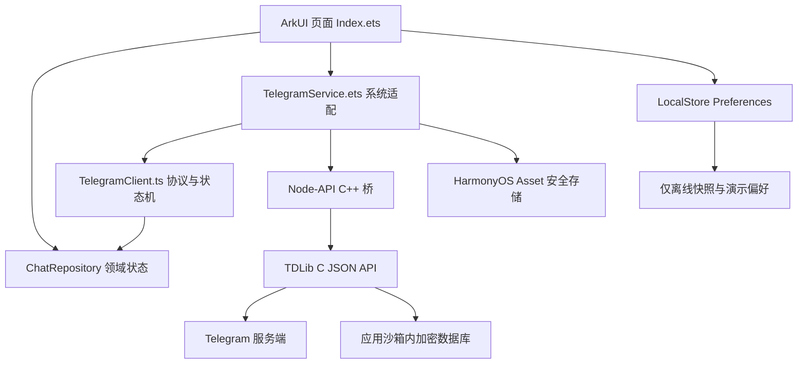

# 架构与边界

本文描述当前工程的分层与真实接入设计。部分真实账号模块仍在本轮集成，是否已经编译、加载和联调，以 `STATUS.md` 的证据为准。

## 分层

箭头表示调用或数据归并方向。协议层通过抽象传输接入 Native，因此可用确定的假传输在宿主机测试；系统 Kit 与设备依赖留在 `.ets` 适配层。

## 界面层

`pages/Index.ets` 管理欢迎、登录、主页、会话和设置等页面状态。界面读取领域模型，并将用户动作交给仓储或 Telegram 服务。用户看到的连接状态来自真实认证和连接更新，不能由点击按钮或本地 Promise resolve 推导。

UI 为本地模式显示清楚的演示标识；对真实模式区分连接中、需要验证、Ready 和错误。发送中、已发送、失败和本地消息保留不同含义。后续拆分组件应围绕会话行、聊天气泡、输入栏和认证表单进行，避免把协议行为搬入组件。

界面采用本机当前 SDK 26（已安装 `26.0.0.105`）的官方 ArkUI 能力。禁止 Android UI 兼容层和 WebView 页面承担应用界面。导航和会话语义参考 Telegram，呈现保持简洁：不加入宣传口号、重复状态标签或无助于用户决策的技术说明；必要连接、认证和错误状态继续可见。详细规范见 [UI_GUIDELINES.md](UI_GUIDELINES.md)。

## 窗口与响应式布局

窗口尺寸是布局输入，设备型号不是。布局读取当前可用内容容器宽度 `vp`；若从 Window API 获取像素宽度，先按当前 `UIContext` 换算，再扣除尚未处理的安全区。不能将整块物理屏幕宽度当作分屏中的应用宽度，也不能重复扣除已由容器处理的安全区。

| 宽度类 | 可用宽度 | 布局策略 |
| --- | --- | --- |
| compact | `< 600 vp` | 会话列表与聊天栈式单栏，返回保留原列表筛选和位置。 |
| medium | `600–839 vp` | 过渡宽度；优先紧凑主从布局，在无法满足面板可操作宽度时保持单栏。 |
| expanded | `>= 840 vp` | 会话列表与聊天主从双栏；正文和气泡有最大宽度。 |

上述为项目初始断点，变更需同步规范与边界测试。手机横屏、平板分屏、折叠展开和阔折叠旋转，都依据同一宽度规则，不写按型号分支。

当前账号、所选会话、输入草稿、搜索筛选与列表滚动锚点归属于页面/领域状态，不归属于某一栏的临时组件实例。旋转或折叠导致组件重建时保留这些状态；宽窄切换不重建协议客户端、不重发消息、不自动把聊天滚到末尾。只有用户处于底部并有新消息到达等明确场景才跟随滚动。

订阅窗口变化后，在页面销毁时解除相应监听；安全区、软键盘和可折叠区域由官方 API 的当前值决定。尽量通过布局容器约束完成适配，避免在尺寸回调中反复修改尺寸形成重排循环。设计验收与真实运行覆盖分别记录在 [RESPONSIVE_VALIDATION.md](RESPONSIVE_VALIDATION.md)。当前用户指定真机验收，不以模拟器补测代替；其他形态未验证时保持明确缺口。

## 领域状态与模式隔离

`model/ChatModels.ts` 定义会话、消息、联系人、草稿和本地快照。`data/ChatRepository.ts` 持有可展示的内存状态，并提供读取、upsert、去重、排序及本地交互操作。

| 模式 | 数据来源 | 发送与保存 |
| --- | --- | --- |
| 离线体验 | `DemoData.ts` 虚构夹具及本机演示快照 | 文本仅写入本地，状态为 `local`；由 `LocalStore` 保存。 |
| 真实账号 | TDLib 更新与历史请求 | 用户动作转成 TDLib 请求；服务器回执决定成功或失败。真实消息不写入演示 Preferences。 |

模式切换必须处理旧订阅、进行中的请求、草稿和当前页面引用。进入离线体验不能无条件覆盖已经恢复的离线数据；退出真实账号不能让延迟更新写回演示仓储。返回仓储的数据与 ArkUI 响应式状态之间通过明确刷新连接，避免仅修改对象字段却不触发界面刷新。

消息去重键是会话 ID 与消息 ID 的组合。发送成功可能替换临时 ID，应删除旧 ID 对应条目并归并新消息。历史分页不得覆盖请求期间到达的新消息或发送中的消息。会话 position.order 按十进制字符串比较，不转为 Number；同 order 的排序需要稳定策略。

## Telegram 协议层

`telegram/TelegramClient.ts` 负责 JSON 请求构造、`@extra` 关联、`@client_id` 归属、认证状态迁移、聊天与消息映射及错误状态；`telegram/TdTypes.ts` 声明协议类型。客户端不依赖 ArkUI、Asset 或真实网络，使协议行为能在宿主机测试。

核心流程为：

1. 创建客户端，收到 `authorizationStateWaitTdlibParameters` 后提供参数。
2. 依服务端状态显示手机号、验证码、二步密码或邮箱验证界面。
3. 只有收到 `authorizationStateReady` 后加载真实会话。
4. 顺序处理会话位置、最后消息、未读、历史与消息发送更新。
5. 关闭或退出时停止新请求，等待关闭状态，并解除订阅与轮询。

`ok` 不等于 Ready；`sendMessage` 请求返回不等于对方已读。未支持的认证分支显示明确提示，不自动跳过。TDLib 升级必须同步 pinned schema 与领域测试，旧版教程的请求字段不能直接套用。

## HarmonyOS 适配

`services/TelegramService.ets` 连接协议客户端、Native 接口、页面订阅与系统生命周期，负责初始化、轮询和关闭。它持有唯一接收循环，更新按接收顺序分发。每轮接收应有上限，避免大量缓存更新占满 ArkUI 主线程。

`services/CredentialVault.ets` 适配 Asset 安全存储，用于数据库加密密钥及应用侧敏感配置，TDLib 数据库和文件目录使用应用沙箱。随机密钥只能通过系统安全随机源生成，不得使用 Math.random、固定值或账号信息派生。首次初始化、重启读取、删除与失败恢复都必须保留可见错误，不能因读取失败悄悄换一把密钥导致数据库无法解密。

`services/LocalStore.ets` 使用 Preferences 处理演示快照，写入按单队列串行。真实账号内容由 TDLib 管理，不保存到演示快照；演示快照损坏保留可诊断状态但不输出正文。

`AppearancePreferences.ets` 在独立 `harlgram_appearance_v1` 中只保存外观 mode，真实账号下也可写入。首次迁移只读取旧 snapshot 的 boolean darkMode，不复制消息；无有效旧偏好默认跟随系统。`AppearanceState` 分离用户三态选择和系统生效色，带版本校验防止延迟读取覆盖新选择；`WindowAppearance` 通过 AppStorage 将选择与实际颜色分发给页面，串行同步窗口背景及系统图标。loadContent 前加载偏好，成功后才调用应用/窗口颜色 API；配置更新、回前台、窗口获焦读取真实系统颜色，不依赖已被应用覆盖的配置。`SystemAppearanceObserver` 接收 ArkUI Environment 颜色变化信号，源注册先于组件初始化；只有跟随系统时重新读取系统色，不改用户偏好。窗口监听随窗口销毁注销，不定时轮询。

## Native 边界

`cpp/napi_init.cpp` 动态加载 `libtdjson.so`，导出：

| 接口 | 约定 |
| --- | --- |
| `getTdlibStatus(): string` | `available` 表示现代 TDLib C API 符号可加载；`not-linked` 表示不可用。 |
| `createClient(): number` | 创建真实客户端并关闭普通日志；缺库或失败抛错。 |
| `send(clientId, request): void` | 校验客户端、字符串类型、UTF-8 大小上限及内嵌 NUL，传递 JSON。 |
| `receive(): string` | 以零超时轮询；无更新返回空串；缺库抛错。 |

`td_receive` 和 `td_execute` 共用互斥保护，返回数据立即复制。动态库保持进程生命周期内加载，避免后台 TDLib 线程仍运行时卸载。协议解析和请求状态保留在 TypeScript 层。Preview mock 明确报告引擎不可用。

## 应用配置与发布

DevEco 签名、Telegram 应用 API 配置、Telegram 用户登录是三类独立身份。用户既有签名配置保持本机管理。普通用户只做账号登录，开发者负责构建时应用 API 配置。

私有源配置为 `config/telegram.local.json`，公开模板为 `config/telegram.example.json`；`scripts/configure-telegram.sh` 生成 `entry/src/main/ets/config/TelegramBuildConfig.ets`，供 `startDefault` 读取。私有源文件与生成文件均在 `.gitignore` 中。项目不内置上游应用或示例 API 凭据。

无配置可以构建界面和启动验证版本，但不能进行手机号鉴权。正式构建需验证开发者自有 API 配置，release guard 应在构建阶段阻止缺失或无效配置进入产物。安全存储与混淆不能把随客户端分发的 API Hash 变成服务器端秘密；不得把用户登录密码放入这类配置。

## 媒体边界

`MediaModels.ts` 只处理附件模型与字符串相册 ID；协议层归并照片/视频、请求发送/下载，不能用本地预览代替发送确认。`AttachmentService.ets` 限定系统 Picker 授权 URI、受控缓存复制、元数据和系统确认保存。`MediaViewer` 负责媒体切换，`PhotoViewer` 保留缩放，`VideoPlayer` 独占 AVPlayer 与文件句柄并在退出时释放；`EntryAbility` 发布前后台状态。全屏媒体临时使用深色系统栏，退出恢复外观偏好；不修改用户的浅色/深色/跟随系统选项。实现范围和真实验收见 [MEDIA.md](MEDIA.md)。

## 消息呈现

富内容由 `telegram/RichMessage.ts` 按固定 schema 解码，输出显式的 `RichContentBlock`；`MessagePresentation.ts` 提供格式/分组/几何纯逻辑，`MessageText.ets` 使用原生 Span 呈现。普通与嵌入媒体共享下载状态更新；嵌入媒体下载必须核实源消息中的文件归属。全文和回复只读请求单独关联，不伪造新消息插入历史。入口、证据和边界见 [MESSAGE_DISPLAY.md](MESSAGE_DISPLAY.md)。

## 存储与下载策略

`StorageModels.ts` 定义类型白名单、大小策略与显式清理参数；`TelegramClient` 关联异步统计/清理请求并处理超时和失效文件状态。`StorageManager.ets` 持有每账户独立策略、维护任务和账户代数校验，所有缓存删除经 TDLib；`MediaNetworkMonitor.ets` 只读取网络类型及漫游状态。`StoragePage.ets` 使用官方 DataPanel、Checkbox、Toggle 与确认弹层，不直接删除沙箱文件。应用只维护当前连接账户，上传暂存保持只读，边界见 [STORAGE_MANAGEMENT.md](STORAGE_MANAGEMENT.md)。

## 原生视频流与控制

`VideoPlayback.ts` 封装有界字节窗口、连续前缀证明、取消和定位合并。`TelegramClient` 验证消息/文件归属，`TelegramService` 绑定账户与连接代数。`VideoHttpStream.ets` 只在临时 loopback 地址提供一个随机路径、一个已授权视频的标准 Range 读取，关闭监听和连接后不保留独立媒体副本。`VideoPlayer` 使用官方 AVPlayer 网络源/完整文件 fd，保留播放意图并等待 seekDone 恢复，单击/双击/横滑/长按交互与控件都留在 ArkUI。安全边界和实际验收见 [VIDEO_PLAYER.md](VIDEO_PLAYER.md)。

## 自建网络中转

`RelayModels.ts` 负责域名/目标验证、增量带认证 SOCKS5 和 nonce 探针；`RelayPreferences.ets` 在独立 Asset 保存配置；`RelayTunnel.ets` 使用官方 NetworkKit 监听 loopback 并承载 WSS 二进制流。`RelaySettings.ets` 提供原生配置页面。TelegramService 管理测试、持久化与连接生命周期，TelegramClient 负责 TDLib 代理确认及网络放行顺序。Native 桥不感知自定义协议。启用失败不回落直连；账户切换重建传输，不改账号密钥和存储边界。协议、限制及独立验收见 [TELEGRAM_RELAY.md](TELEGRAM_RELAY.md)。

网络管理使用 `RelayRegistry` v2（配置 ID、名称、域名、令牌请求头、令牌，以及独立的 activeId）。直接连接以空 activeId 表达，切换直连保留全部配置；旧单配置 Asset 在读取时迁移为一条记录，成功保存时才原位写入 v2，不另开可导致回退的存储别名。编辑非活动项不重连；活动项修改/切换先探针验证，成功才持久化并重连同一账号。写入失败尝试恢复原连接；连接失败后页面重新读取实际已保存选择。删除当前项须先选择其他连接方式。默认 Authorization 使用 Bearer 前缀，其他自定义令牌头发送原始令牌；拒绝连接/协议保留头与 CR/LF。
